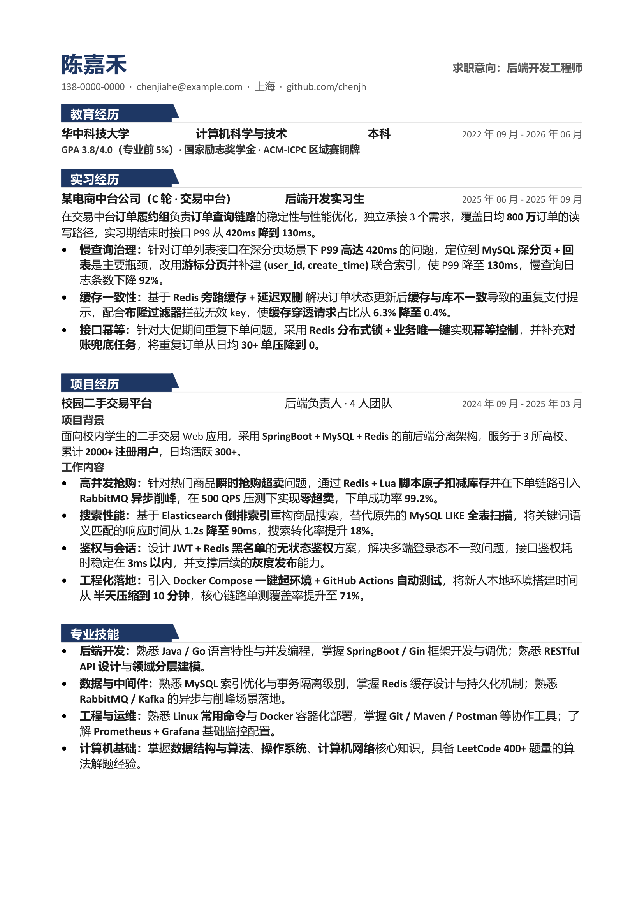

# 简历制作 Skill

把零散的经历笔记、一份旧简历，或者一段目标岗位 JD，做成一份 **HR 三秒能扫完、可以直接投递的中文 Word 简历**。



## 它能做什么

- **从 JD 反推着写**：抽出岗位关键词，把已有的经历按岗位重心重排、重写，而不是套模板。
- **重构旧简历**：把「负责后端开发」「使用了 Redis」这类空话，改写成「主题词 + 痛点 + 动作 + 结果」。
- **固定版式出 Word**：单栏一页纸、主题色右斜切色块标题、通栏浅灰分隔线、悬挂缩进列表、局部加粗。版式由脚本保证，不靠模型即兴发挥。
- **先草稿后成稿**：先给你一份 Markdown 草稿过目，确认后才生成 `.docx`。
- **不编造**：没有实习就不写实习；没给的数字按场景保守估算，但会在草稿末尾单独列出来让你确认。

## 安装

### 方式一：作为 Claude Code 插件（推荐）

```text
/plugin marketplace add zzzlip/resume-builder-skill
/plugin install resume-builder@resume-builder-skill
```

### 方式二：直接放进 skills 目录

```bash
git clone --depth 1 https://github.com/zzzlip/resume-builder-skill.git /tmp/rb
mkdir -p ~/.claude/skills
cp -r /tmp/rb/skills/resume-builder ~/.claude/skills/
```

装好后重开一个 session，说「帮我做份简历」就会自动触发。

## 怎么用

把材料直接丢给它就行：

> 帮我做份简历，我要投这个 JD（贴岗位描述），我的情况在 notes.txt 里，写得有点乱。

它会走四步：读 JD 抽关键词 → 写结构化数据 → 自检（页数、加粗密度、bullet 长度）→ 给你 Markdown 草稿 → 你确认后生成 Word。

也可以直接指定版式参数：

```bash
python3 scripts/build_resume.py build resume.json -o 简历-张三.docx --theme 2D6A4F
```

## 版式规则

| 元素 | 规则 |
| --- | --- |
| 版面 | A4 单栏，左右边距 2.0cm，正文 10.5pt / 行距 14pt |
| 姓名 | 20pt 加粗主题色，右侧右对齐「求职意向」 |
| 模块标题 | 3.6cm 主题色右斜切色块 + 白色 11pt 加粗标题，底部通栏 0.5pt 浅灰线 |
| 经历标题行 | 三/四列，前三项加粗，时间 9pt 灰色右对齐 |
| 列表 | 实心 `•`，悬挂缩进 0.6cm（折行与首行文字左对齐，不与圆点对齐） |
| 加粗 | 只加粗专有名词、方法/工具、量化结果，每条 2～4 处 |
| 间距 | bullet 内紧凑、bullet 间 2pt、经历间 6pt、模块间 12pt |

主题色默认深藏蓝 `#1F3864`，换浅色时脚本会自动把标题文字切成深色。

## 为什么是零依赖

`scripts/build_resume.py` 只用 Python 标准库（`zipfile` / `zlib` / `struct`）直接手写 OOXML，斜切的梯形色块是脚本自己栅格化的 PNG。所以你不需要装 python-docx、docx-js、LibreOffice 或 pandoc——**任何有 python3 的环境都能跑**，包括没有图形界面的沙箱。

`scripts/read_docx_text.py` 同样是纯标准库，用来把旧简历读成纯文本再重构。

## 目录

```text
skills/resume-builder/
├── SKILL.md                 # 工作流、铁律、命令行
├── references/
│   ├── schema.md            # resume.json 字段表与渲染映射
│   └── writing.md           # Bullet 公式、加粗纪律、反例、不满一页怎么补
├── scripts/
│   ├── build_resume.py      # preview / check / build
│   └── read_docx_text.py    # 旧简历抽取
└── evals/                   # 三个端到端用例与 fixtures
```

## 已知边界

- **不编造公司、职位、学历、时间、证书**。这是硬约束，宁可少写。
- 量化数据分两种：你给了就用你的，不许改口径；没给会保守估算，并在草稿里点名让你替换。
- 一页纸是默认目标，1～2 页可接受。版面明显不满一页时会主动补内容，优先把工作经历里的子系统拆成项目经历。
- 中文版式针对中国大陆求职习惯设计；英文学术 CV、欧美格式需要另外调整。

## License

MIT
